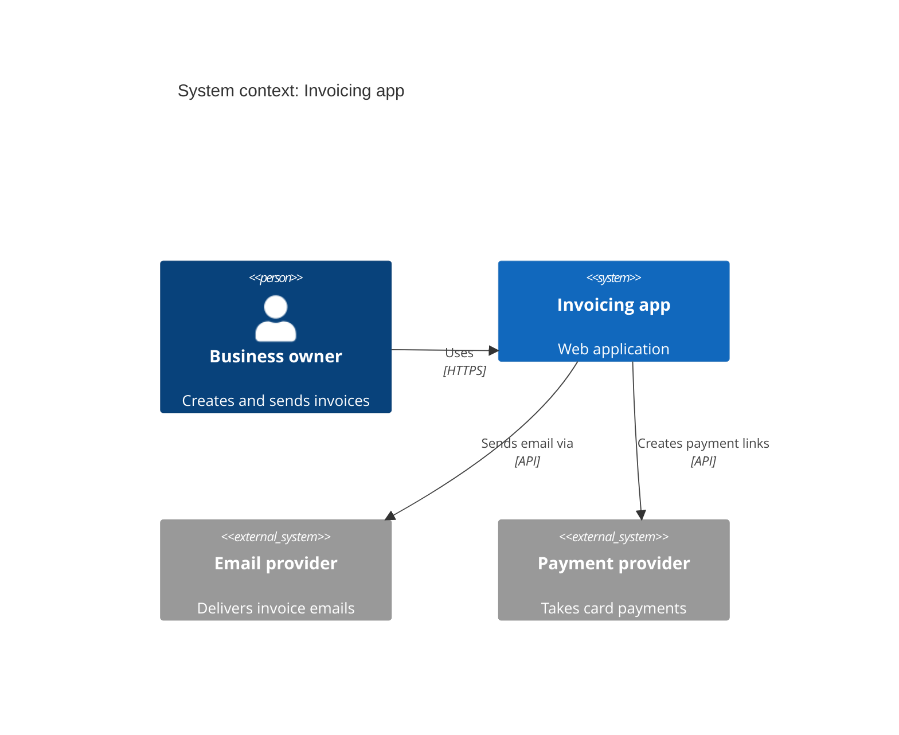
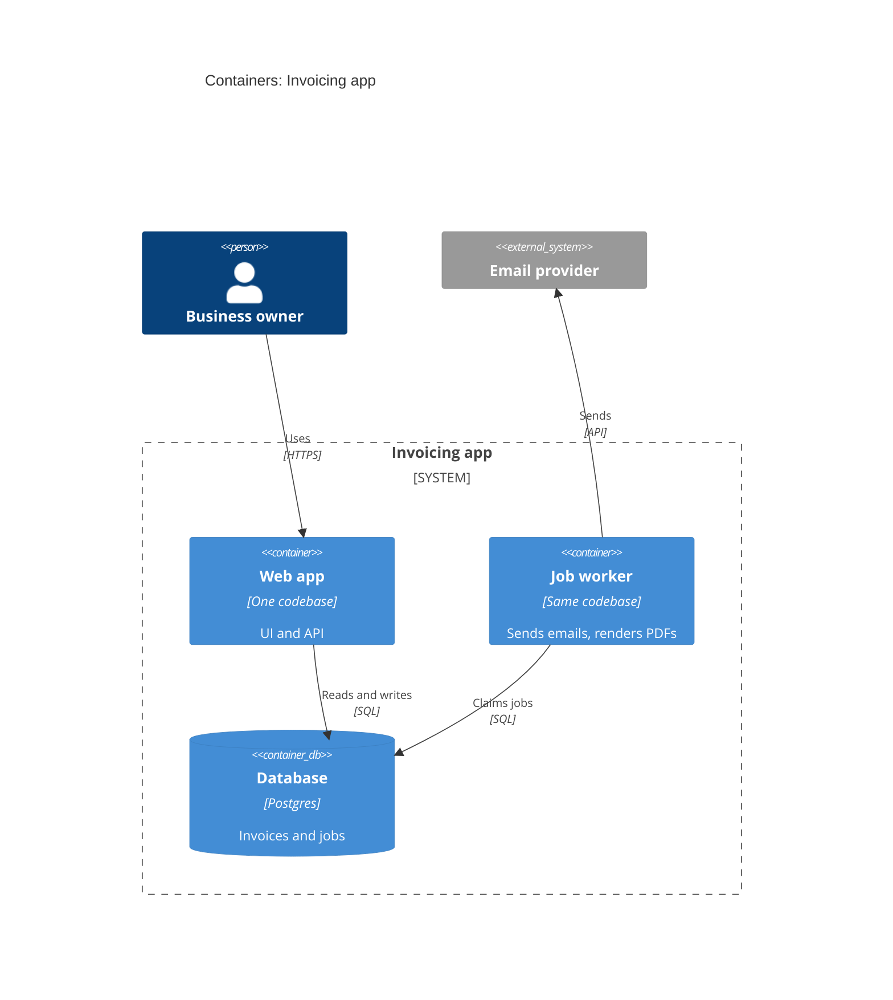
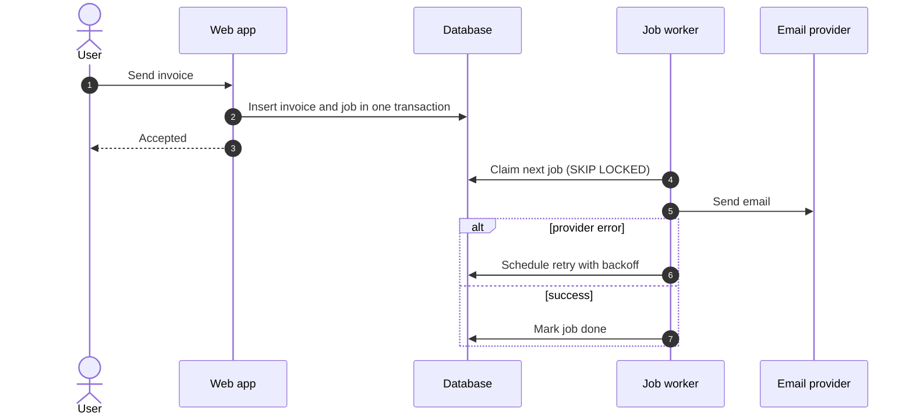
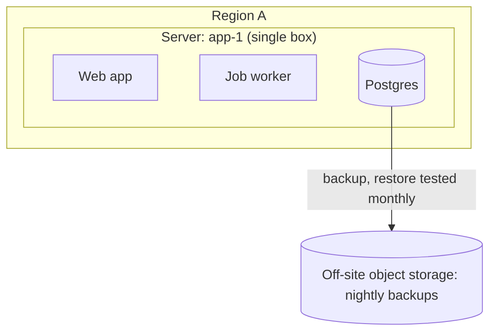
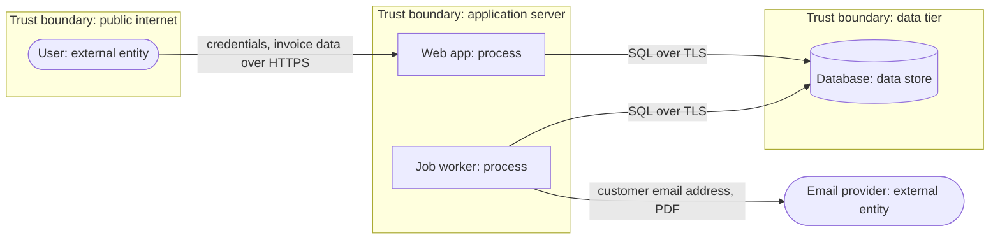
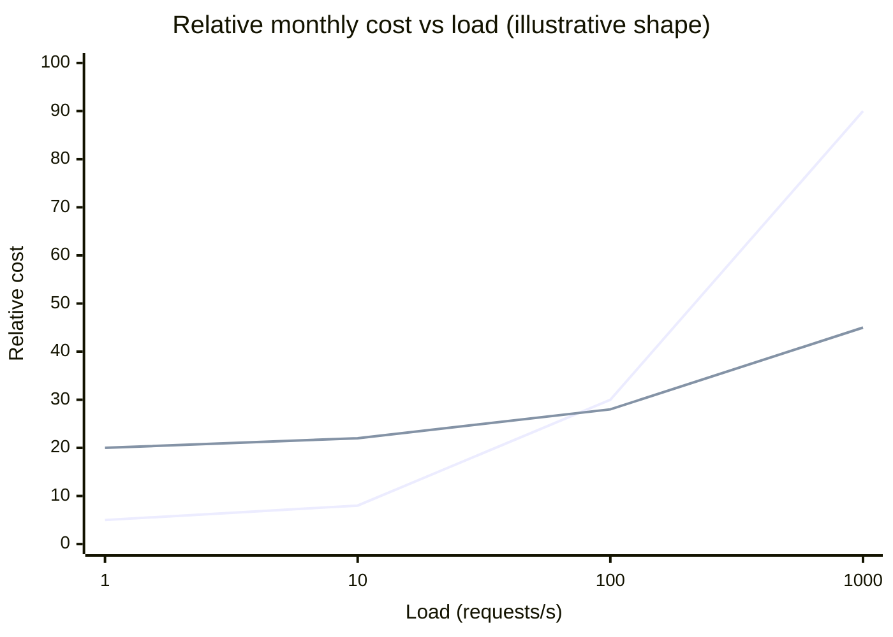
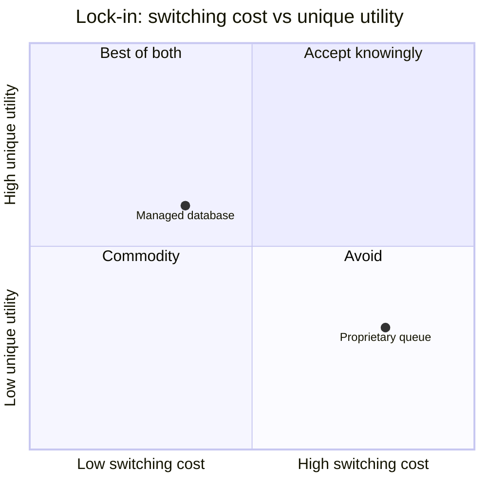

# Diagram selection

Pick the diagram by the question the owner is asking. Draw one diagram per question, at one abstraction level.
The brief carries at most one focal diagram; further views go in the ADR or an appendix. C4 is notation- and
tool-independent; the views below map onto it (https://c4model.com/).

**Format.** Use the repository's or output's existing diagram convention first. Otherwise pick a text-native
format confirmed to render in the target (repository host, document tool, PDF, email), and check the rendered
result before sending. Mermaid is a reasonable fallback where the target renders it; it supports C4 syntax
(https://mermaid.js.org/syntax/c4.html). If nothing renders, ship the source plus the text equivalent.

| Owner's question | Diagram | Include when |
|---|---|---|
| What is this, who uses it, what does it talk to? | C4 System Context | For a new or changed system, only when the audience lacks shared context. Aim for 5–9 boxes |
| What are the deployable pieces and technology choices? | C4 Container | Usually the focal diagram |
| What happens, in what order, and what if a step fails? | Sequence (C4 Dynamic) | Latency, retries, failure paths |
| Where does it run, and what fails together? | Deployment | Hosting, HA, DR, cost-per-node questions |
| Where can it be attacked, and where does sensitive data go? | Data-flow diagram with trust boundaries | Security, privacy, compliance questions; then apply STRIDE (https://cheatsheetseries.owasp.org/cheatsheets/Threat_Modeling_Cheat_Sheet.html) |
| How does it fit the wider estate? | C4 System Landscape | Multi-system proposals only |
| What's inside one container? | C4 Component | Only if the decision hinges on it |
| How do options' costs behave as load grows? | Cost curve (line per option, crossover marked) | Cost-driven decisions (a design suggestion, not a researched standard) |
| How do options compare on two dimensions? | 2×2 quadrant | Positioning a few options; label the axes with real meaning |

**Charts to avoid:** radar or spider charts. Their area depends on axis order and they are hard to compare; use a
table or a bar or dot chart per criterion (https://www.perceptualedge.com/articles/dmreview/radar_graphs.pdf).

**Other diagrams-as-code categories**, by need: PlantUML-family C4 libraries for teams already on PlantUML
(https://plantuml-stdlib.github.io/C4-PlantUML); model-based DSLs that keep several C4 views consistent from one
model (https://docs.structurizr.com/dsl/language); declarative layout languages for polished standalone diagrams
(https://d2lang.com/). Check current syntax in each tool's docs; syntax evolves.

## Communication checklist (every diagram)

- One sentence: who the reader is and what question this diagram answers.
- A title and a purpose line.
- Every element at the same abstraction level.
- Names consistent across all views and the text.
- The primary path visually dominant.
- A legend that explains notation, not the story.
- Labelled relationships: what flows, and over what protocol.
- **Text equivalent next to the diagram:** prose stating the conclusion, the principal relationships and any
  material failure or trust boundaries. A reader who can't see or render the diagram loses nothing essential.
- Rendering checked in the target format.

Checklist structure adapted (attribution only) from magnus919's C4 communication review (MIT,
https://github.com/magnus919/agent-skills/blob/main/c4-diagramming/references/technical-diagram-communication.md);
the rules rest on C4 (https://c4model.com/) and the OWASP data-flow guidance above.

---

## Snippets (illustrations: a hypothetical invoicing app)

### System context

### Container

### Sequence (with a failure path)

### Deployment

### Data flow with trust boundaries

### Cost curve (shape only; no real prices)

*Caption the lines in text (this chart type has no legend). E.g. "Line 1: pay-per-use; line 2: fixed server.
Crossover near 100 req/s under the stated assumptions."*

### 2×2 quadrant (switching cost vs unique utility, after Hohpe's lock-in matrix)

Lock-in framing: https://martinfowler.com/articles/oss-lockin.html (quadrant labels are ours).
